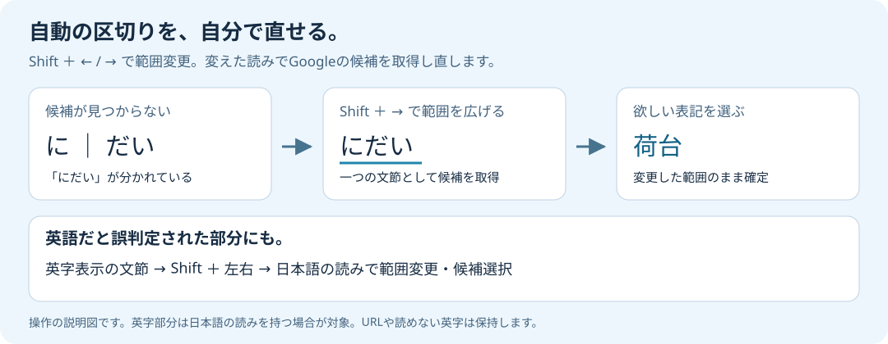
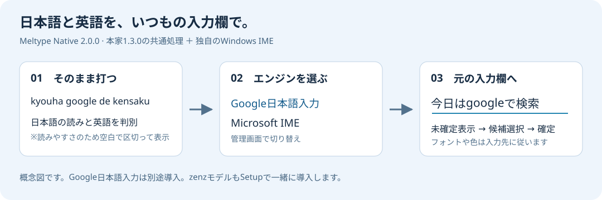
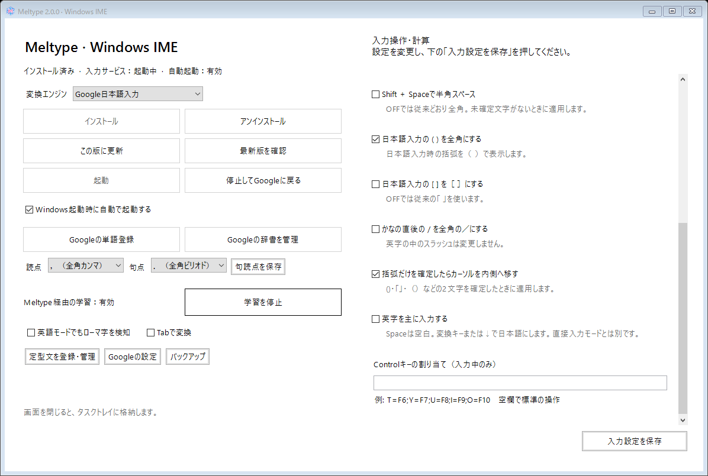

# Meltype Native 2.0.0

**Google日本語入力の辞書を使い、変換の区切りを自分で直せる日英混在IME。**

[ダウンロード](https://github.com/AoneSenbongi/Meltype/releases/tag/native-google-2.0.0) · [導入手順](docs/NATIVE_IME_TRANSFER.md) · [変更点と検証](docs/RELEASE_2_0_0.md) · [不具合の報告](https://github.com/AoneSenbongi/Meltype/issues)

[雪代／Yukishiro氏のMeltype](https://github.com/yksr-melt/Meltype)を基にした非公式Windows Forkです。本家1.3.0の日英自動判別・共通変換処理・辞書を基礎に、**Google日本語入力との連携と、入力欄での文節編集**を組み合わせています。Windows 10／11 x64向けです。Googleや元作者の公式配布版ではありません。

## このForkでできること

### 1. 変換の区切りを変えて、欲しい候補を選ぶ

**変換結果が違っていたら、打ち直す前に文節の区切りを直せます。**

Spaceで変換し、左右キーで対象の文節へ移動します。Shift＋左右で読みの範囲を縮めたり広げたりすると、その範囲でGoogleの変換候補を取得し直します。自動で切られた文節だけに候補を限定しません。



たとえば「にだい」が「に｜だい」に分かれて「荷台」が見つからないときは、文節を「にだい」に広げて候補から選べます。Googleが返した元の区切りに戻すことなく、変更した範囲の候補を取得する独自処理を加えています。[文節候補の取得方法](docs/GOOGLE_SEGMENT_CANDIDATES.md)

**意図せず英語と判定された部分も、Shift＋左右で修正できます。** 日本語として読める入力であれば、その読みで文節を作り直して変換します。全文が英字表示になった場合も操作を始められます。日本語文節だけを編集対象にする従来のGoogle連携から拡張しています。

文節の範囲変更という操作自体は本家にもあります。このForkの追加点は、**独自のGoogle連携でも区切り変更・候補の再取得・英語誤判定からの修正を一続きで行えること**です。URLや日本語として読めない英字は無理にかなへ変えません。[英語文節の対応範囲](docs/CONTROL_PANEL_AND_ENGLISH_BOUNDARY.md)

### 2. Googleの辞書・学習履歴を引き継いで使う

インストール済みのGoogle日本語入力へ変換を依頼します。普段使っているユーザー辞書と学習履歴を利用でき、単語登録・辞書管理もGoogleの画面から行えます。学習を有効にした場合は、確定結果の一致を確認してGoogleへ学習させます。Google本体やシステム辞書は改造・同梱しません。

管理画面でMicrosoft IMEへ切り替えることもできます。初期値はGoogleです。Microsoftの候補APIはIME本体と候補順が一致するとは限らず、Microsoft辞書への学習書き込みには未対応です。[エンジンの仕様](docs/NATIVE_ENGINE_MODE.md)

### 3. 管理画面から設定・辞書・更新を操作する

入力操作の設定は主管理画面に直接配置しています。句読点、学習、自動起動、Googleの辞書、定型文も同じ画面から操作できます。セットアップと管理画面の更新機能には、SHA-256照合と更新前のバックアップを組み込んでいます。

未確定文字は元の入力欄に表示し、独自の候補画面を入力位置の近くに出します。本家のWindows TIPとは別のTSF実装です。



## 本家1.3.0から引き継いでいる機能

以下は本家由来の機能です。このForkでは、独自のWindows入力処理へ接続して使います。

| 機能 | Native 2.0.0での対応 |
| --- | --- |
| 日英自動判別・共通辞書 | 対応。日本語を変換し、英語と判別した部分は英字で残します |
| 予測変換 | 対応。Tab／Shift＋Tabで候補選択、Enterで確定 |
| 定型文 | 対応。登録・編集・削除・JSON入出力、`;名前`のSpace／Tab展開 |
| 計算候補 | 対応。数式をSpaceで変換して結果を選択。独自の新機能ではありません |
| Escの段階取消・選択文節の取消 | 設定で切り替え可能 |
| Enterの表示どおり確定・F9／F10初回操作 | 設定で切り替え可能 |
| 選択文節へのF6〜F10 | 対応 |
| 空白・括弧・スラッシュ・角括弧の表記 | 主管理画面で設定可能 |
| 括弧対の確定後に内側へ移動 | 対応。Native側で位置が外へ戻る不具合を修正 |
| 英字優先入力・Controlキーへの操作割り当て | 主管理画面で設定可能 |
| 新しい「雪の結晶＋M」アイコン | IME・管理画面・トレイ・Setupへ反映 |

句読点の選択、学習の停止・再開、再変換、Tab変換も利用できます。本家の番号は1.3.0、このForkの配布番号は2.0.0です。同じ番号体系ではありません。

## 本家から変更・追加した部分

| 部分 | このForkでの変更 |
| --- | --- |
| Google変換 | 非公式IPCによる接続、既存辞書・履歴の利用、確定結果の学習 |
| 文節編集と候補 | Googleの区切りを手動変更し、その読み全体の候補を取得。英語誤判定部分にも対応 |
| エンジンの選択 | 管理画面でGoogle／Microsoftを切り替え |
| Windows入力処理 | 独自TSF、元の入力欄への未確定表示、候補表示と位置調整 |
| 管理と配布 | 独自管理画面、設定の直接配置、EXE導入・更新確認・バックアップ |
| ローカルAI連携 | zenzで文脈に合う候補を評価する独自実装。配布構成は次節を参照 |

## 本家の機能のうち、Native 2.0.0では未対応のもの

以下は共通ソースにコードがあっても、Nativeの操作・設定には接続していません。本家の設定ファイルをコピーしても有効になりません。

| 機能 | 状態 |
| --- | --- |
| 子音の略入力 | 未対応 |
| 前の文脈ごとに分ける日英学習 | 未対応 |
| 英字の社名・サービス名を予測候補に追加 | 未対応 |
| GitHub Issue／PRのタイトル候補 | 未対応 |
| クリップボードの内容を変換候補に追加 | 未対応 |
| 打鍵間隔の実験記録 | 未対応 |

本家のコードエディター向け判別や各OS向けの機能も、すべてをNativeで再現したものではありません。Mac／LinuxのNative Google連携パッケージは配布していません。

## zenzもSetupで一緒にインストール

**ローカルAIモデルと推論ランタイムをSetup.exeに同梱します。別途ダウンロードや手動設定は不要です。**

Googleなどが生成した候補を、前後の文脈と合わせて`zenz-v3.2-small`に評価させる独自機能です。モデルが自由に生成した文を無条件に挿入する方式ではなく、変換エンジンが用意した候補の範囲から採用します。文節を手動で直す操作とは別に働きます。

入力時には既存エンジンの結果を表示し、入力が止まってから文脈評価します。候補の選び直しは非同期で行い、手動選択・確定・取消の後に古い結果を適用しません。モデルの自動判断を、そのまま新しい学習として蓄積しません。

- **PC内で処理**：モデルはCPUで推論します。入力をクラウドAIへ送信せず、GPUやAPIキーは不要です。
- **約74MBのモデル**：Q5_K_M量子化版とCPU推論用runtimeを同梱し、配置先が違うPCでも動く相対設定で導入します。
- **CPU条件**：zenzの動作にはAVX2対応CPUが必要です。非対応CPUではモデルを起動せず、通常のGoogle／Microsoft変換を使います。
- **範囲と限界**：候補にない表記を新たに作る機能ではありません。CPU負荷と待機時間が増え、日常入力の精度向上を一律に保証しません。

[モデル](https://huggingface.co/Miwa-Keita/zenz-v3.2-small-gguf)はApache-2.0、[使用runtime](https://github.com/azooKey/llama.cpp/blob/b4846/LICENSE)はMITです。配布物へライセンス全文と出典通知を同梱します。[同梱構成と検証](docs/BUNDLED_ZENZ.md)

## インストール

1. Windows 10／11 x64でGoogle日本語入力をインストールし、一度日本語を入力して動作を確認します。
2. [2.0.0のRelease](https://github.com/AoneSenbongi/Meltype/releases/tag/native-google-2.0.0)から`Meltype-Native-Google-2.0.0-Setup.exe`を取得して開きます。
3. 保存先とショートカットを確認し、必要なWindowsの管理者確認を承認します。導入後にIMEが起動します。
4. スタートメニューかデスクトップの「Meltypeの管理画面」を開きます。更新した場合は入力アプリも開き直してください。

ランタイムは同梱しています。別途.NET、Codex、開発環境を入れる必要はありません。ARM用・32ビット用パッケージは提供していません。従来のMeltype常駐版が動いている場合は先に終了してください。

コード署名はありません。SmartScreenの未署名警告と、ウイルス対策の脅威検出は別です。脅威検出時は保護を無効にせず、定義を更新して再確認し、検出名と版番号を報告してください。Releaseの`.sha256`と次の結果を照合できます。

```powershell
Get-FileHash .\Meltype-Native-Google-2.0.0-Setup.exe -Algorithm SHA256
```

旧ZIPからの更新も含め、[詳しい導入手順](docs/NATIVE_IME_TRANSFER.md)を参照してください。

## 入力してみる


図は操作例です。実際のフォント・色・候補順は入力先や変換エンジンにより異なります。

| やりたいこと | 操作 |
| --- | --- |
| 日英を混ぜて入力 | 自動モードでローマ字入力。例：`kyouhagoogledekensaku` → 「今日はgoogleで検索」 |
| 変換・確定 | Spaceで変換候補を選び、Enterで確定 |
| 文節選択・範囲変更 | 変換中に左右で文節移動、Shift＋左右で範囲変更 |
| 予測候補を選ぶ | Tab／Shift＋Tabで選択、Enterで確定、Escで選択解除 |
| 自動／英語を切り替え | 入力モードボタン、または半角／全角キー |
| 選択文字を再変換 | かな・漢字・ローマ字を選択し変換キー。Enterで確定、Escで復元。読みを取れない場合は変更しません |
| 定型文を展開 | 管理画面で登録後、行頭か空白の直後に`;名前`を入力してSpace／Tab。展開直後のEscで元に戻せます |
| 数式を計算 | 計算候補を有効にし、`1+2*3` → Space。候補から`7`や`1+2*3=7`を選択 |
| 括弧内に移動 | 「括弧だけを確定したらカーソルを内側へ移す」をONにして保存。`()` → Enter |

Google選択時は、日本語の読みが4文字以上になるとSpaceの前にもライブ変換で表示を更新します。表示更新だけで文字を確定することはありません。計算は変換候補から結果を選ぶ方式です。

英語文節の範囲変更は、かなの読みを持つ文節が対象です。URLや読めない英字を強制的に日本語へ変えません。英語直接入力中のShift＋左右は、入力先の範囲選択として扱います。

## 管理画面で設定する



検証時に保存した実画面です。右側を下へスクロールした状態です。チェック値は撮影時の設定で、新規導入時の既定値ではありません。

1. **左側で基本設定**：エンジン、句読点、学習の停止・再開、自動起動、Googleの辞書、定型文を管理します。
2. **右側で入力操作**：計算、Esc・Enter・Fキー、空白、括弧・記号、英字優先、Controlキーの割り当てを設定します。上下にスクロールできます。
3. **設定を保存**：右側は「入力設定を保存」、句読点は「句読点を保存」を押します。次の入力から反映します。

管理画面を閉じると通知領域へ格納します。Meltypeアイコンの右クリックから停止・単語登録・辞書管理も操作できます。「管理画面を終了」は管理画面だけを終了します。

「英語モードでもローマ字を検知」と「英字を主に入力する」は別の設定です。前者は直接入力中のローマ字検知、後者は入力中の自動判別を抑え、変換キーや↓で日本語へ切り替える操作です。[入力設定の仕様](docs/PRERELEASE_INPUT_2_0_1_RC_8.md)

## データとプライバシー


入力の判別と変換エンジンへの要求はPC内で処理します。このForkに入力文字を外部サーバーへ送信する処理は追加していません。「最新版を確認」ではGitHubへ接続してRelease情報と配布物を取得します。Google日本語入力本体の通信設定は別です。

| データ | 扱い |
| --- | --- |
| Googleの辞書・学習履歴 | 導入先の既存データを利用。Googleの辞書管理画面で操作 |
| Meltypeの設定・予測履歴 | PC内に保存。学習停止中は新規追加を止め、既存履歴は利用 |
| 定型文 | `%LOCALAPPDATA%\Meltype\snippets.json`に保存。Google辞書とは別 |
| 更新前バックアップ | 導入先の`backups`に保存。個人の辞書・学習情報を含むため公開しないでください |

配布EXEには開発者個人の設定・辞書・入力履歴を同梱しません。Meltype経由の学習停止は、Googleを直接使う場合の学習設定を変更しません。[権限・保存先・ログ](SECURITY.md)

## 更新・停止・削除

1. **更新**：「最新版を確認」で通常Releaseを確認します。更新を選ぶと取得、SHA-256照合、バックアップ、セットアップを行います。新しいEXEを直接開いても更新できます。
2. **切り替え**：「停止してGoogleに戻る」で通常のGoogleへ戻します。入力先と合わない場合はWin＋Spaceでも入力方式を切り替えられます。
3. **削除**：Windowsのアプリ一覧からアンインストールします。Googleの辞書・学習履歴とバックアップは残します。登録解除に失敗した場合はファイルを残して中止します。

無操作で更新する方式ではありません。DLL更新後も開いたままの入力アプリは旧DLLを使い続けるため、再起動してください。旧ZIPから更新した場合は従来の導入先も保持します。[更新の仕様](docs/NATIVE_RELEASE_UPDATE.md)

## 検証と制限

共通・Windows回帰637/637、Native20/20、Google16/16、Microsoft2/2が通過しました。TSF文書の変換・確定・取消・文節操作に加え、通常のWindows EDITで`()` → Enterの不具合を再現し、修正後に内側の位置を保持することを確認しました。PC適用後、利用者の実操作でも成功報告を受領しています。[検証の詳細](docs/RELEASE_2_0_0.md)

- すべての入力先での動作を保証するものではありません。32ビットアプリ、一般のストアアプリ、複数モニターは今回の網羅試験対象ではありません。
- Windows検索欄は過去の開発用PC等で確認していますが、Windows 10／11の全構成の確認ではありません。[検証範囲](docs/NATIVE_SEARCH.md)
- Google連携は非公式IPCです。Googleの更新で接続できなくなる可能性があります。Google本体やシステム辞書は改造・同梱していません。
- zenzはCPU推論です。AVX2非対応CPUではモデルを起動しません。日常入力の精度向上や速度を一律に保証しません。

不具合の報告には、版番号・アプリ名・入力操作・期待した動作・実際の動作を添えてください。起動失敗時は画面のメッセージと`experimental-build`内の`native-broker-errors.txt`・`native-broker-output.txt`も確認できます。ログを添付する前に個人情報を確認してください。

## Android・Mac・Linux

Android試作版は[別のRelease](https://github.com/AoneSenbongi/Meltype-Android/releases)です。このWindows 2.0.0とは版番号・配布物・検証範囲が異なり、WindowsのGoogle辞書とも連携しません。

本家のMac・Linux版は[元のリポジトリ](https://github.com/yksr-melt/Meltype)を参照してください。このForkからMac／LinuxのNative Google連携パッケージは配布していません。

## 開発・謝辞・ライセンス

日英判別と共通処理は、本家Meltypeと協力者の成果に基づきます。新アイコンも本家1.3.0のものです。[本家のREADME](README.UPSTREAM.md)を保存していますが、このForkの導入と対応範囲は本書を参照してください。

[lnkiai氏のIME化Fork](https://github.com/lnkiai/Meltype/releases/tag/ime-1.0.1-2)の入力スコープ保護と通信先確認も参考にしています。コード内の著作権・GPL表記を保持しています。

MeltypeとこのForkは[GNU GPL v3以降](LICENSE)です。Setupには`corresponding-source.zip`として対応ソースを同梱します。ランタイムのライセンスと第三者通知は`runtime/LICENSE.txt`・`runtime/ThirdPartyNotices.txt`を参照してください。無保証で提供します。

開発者向け：[ビルド手順](docs/NATIVE_IME_SETUP.md) · [Google連携](docs/GOOGLE_IME_EXPERIMENT.md) · [1.3.0統合範囲](docs/UPSTREAM_1_3_0.md)
