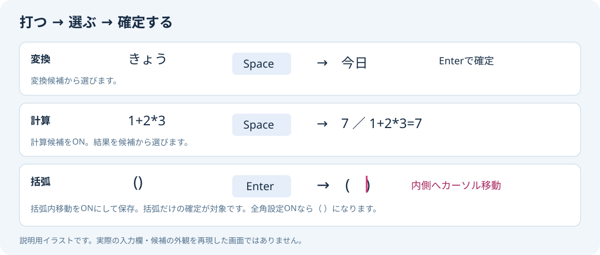

# Meltype Native 2.0.0

**日英を判別し、いつもの入力欄で変換。Google日本語入力の辞書も使えるWindows IME。**

[ダウンロード](https://github.com/AoneSenbongi/Meltype/releases/tag/native-google-2.0.0) · [導入手順](docs/NATIVE_IME_TRANSFER.md) · [変更点と検証](docs/RELEASE_2_0_0.md) · [不具合の報告](https://github.com/AoneSenbongi/Meltype/issues)


[雪代／Yukishiro氏のMeltype](https://github.com/yksr-melt/Meltype)を基にした非公式Forkです。本家1.3.0の共通変換処理・日英判別・辞書を取り込み、独自のWindows TSF実装と管理画面を使います。Googleや元作者の公式配布版ではありません。改良は`google-native-ime`ブランチで管理しています。

**Windows 10／11 x64向けです。** Google日本語入力を別途インストールして使う構成を標準とし、管理画面でMicrosoft IMEにも切り替えられます。モデルや開発環境の準備は不要です。

## 本家との違い

本家にもWindows IMEがあります。「IMEとして動く」「計算する」こと自体が、このForkだけの機能という意味ではありません。共通機能を独自の入力処理へ接続し、Googleとの連携や管理方法を変更しています。

| 項目 | 本家1.3.0との関係 | このForkの2.0.0 |
| --- | --- | --- |
| 日英自動判別・共通辞書 | 本家由来 | 日本語を変換し、英語と判別した部分は英字で残します |
| 変換エンジン | 独自の選択・連携 | Google日本語入力／Microsoft IMEを管理画面で選択。初期値はGoogleです |
| Googleの辞書・学習 | 独自連携 | 導入先の既存データを利用。学習が有効なら、一致確認した確定結果をGoogleへ学習させます |
| 入力欄と候補表示 | 独自TSF実装 | 未確定文字は元の入力欄、候補は入力位置の近くに表示します |
| 英語に誤判定された文節 | 独自修正 | かなの読みを持つ文節もShift＋左右で範囲を変更し、日本語として変換し直せます |
| 入力操作・計算 | 本家機能をNativeへ接続 | 主管理画面で設定し、「入力設定を保存」で反映します |
| 括弧内への移動 | Native側を修正 | 設定ONで括弧対だけを確定すると、内側へカーソルを移します |
| 予測・定型文 | 本家由来＋Native接続 | Tabで予測選択、`;名前`で登録文を展開します |
| 導入・更新 | 独自の管理・配布 | EXEセットアップ、更新確認、SHA-256照合、更新前バックアップ |
| アイコン | 本家1.3.0由来 | 「雪の結晶＋M」をIME・管理画面・トレイ・Setupで使用 |

Microsoftの候補APIはIME本体と候補順が一致するとは限らず、Microsoft辞書への学習書き込みには未対応です。「単語登録」「辞書管理」「Googleの設定」はGoogle専用です。[エンジンの仕様](docs/NATIVE_ENGINE_MODE.md)

### 本家の機能すべてには対応していません

子音略入力、文脈ごとに分ける日英学習、英字の社名・サービス名予測など、本家の追加設定すべてをNative管理画面へ接続したものではありません。本家のコードエディター向け判別や各OS向け機能も、このWindows配布物での提供を保証しません。本家の設定ファイルをコピーするだけで有効になるわけではありません。

### zenzは別途モデルが必要です

独自実装には、ローカルzenzで文脈に合う変換候補を評価する連携経路があります。開発用PCでは`zenz-v3.2-small`で検証していますが、**公開EXEにモデル本体やそのPC固有の設定は含みません。通常の導入だけでzenzが起動する構成ではありません。**

モデル未設定でもGoogle／Microsoftの変換を使えます。モデル連携は開発者向けで、自動ダウンロードや管理画面からのモデル導入は提供していません。[候補評価の実装](https://github.com/AoneSenbongi/Meltype/blob/google-native-ime/src/Meltype.Core/Composition/ContextEvaluation.cs)・[起動と検証](https://github.com/AoneSenbongi/Meltype/blob/google-native-ime/tools/native-ime/NativeContextModel.ps1)を参照してください。本家Mac版の依存先にあるzenz関連コードとは別の連携です。

## インストール

1. Windows 10／11 x64でGoogle日本語入力をインストールし、一度日本語を入力して動作を確認します。
2. [2.0.0のRelease](https://github.com/AoneSenbongi/Meltype/releases/tag/native-google-2.0.0)から`Meltype-Native-Google-2.0.0-Setup.exe`を取得して開きます。
3. 保存先とショートカットを確認し、必要なWindowsの管理者確認を承認します。導入後にIMEが起動します。
4. スタートメニューかデスクトップの「Meltypeの管理画面」を開きます。更新した場合は入力アプリも開き直してください。

ランタイムは同梱しています。別途.NET、Codex、開発環境を入れる必要はありません。ARM用・32ビット用パッケージは提供していません。従来のMeltype常駐版が動いている場合は先に終了してください。

コード署名はありません。SmartScreenの未署名警告と、ウイルス対策の脅威検出は別です。脅威検出時は保護を無効にせず、定義を更新して再確認し、検出名と版番号を報告してください。Releaseの`.sha256`と次の結果を照合できます。

```powershell
Get-FileHash .\Meltype-Native-Google-2.0.0-Setup.exe -Algorithm SHA256
```

旧ZIPからの更新も含め、[詳しい導入手順](docs/NATIVE_IME_TRANSFER.md)を参照してください。

## 入力してみる



図は操作例です。実際のフォント・色・候補順は入力先や変換エンジンにより異なります。

| やりたいこと | 操作 |
| --- | --- |
| 日英を混ぜて入力 | 自動モードでローマ字入力。例：`kyouhagoogledekensaku` → 「今日はgoogleで検索」 |
| 変換・確定 | Spaceで変換候補を選び、Enterで確定 |
| 文節選択・範囲変更 | 変換中に左右で文節移動、Shift＋左右で範囲変更 |
| 予測候補を選ぶ | Tab／Shift＋Tabで選択、Enterで確定、Escで選択解除 |
| 自動／英語を切り替え | 入力モードボタン、または半角／全角キー |
| 選択文字を再変換 | かな・漢字・ローマ字を選択し変換キー。Enterで確定、Escで復元。読みを取れない場合は変更しません |
| 定型文を展開 | 管理画面で登録後、行頭か空白の直後に`;名前`を入力してSpace／Tab。展開直後のEscで元に戻せます |
| 数式を計算 | 計算候補を有効にし、`1+2*3` → Space。候補から`7`や`1+2*3=7`を選択 |
| 括弧内に移動 | 「括弧だけを確定したらカーソルを内側へ移す」をONにして保存。`()` → Enter |

Google選択時は、日本語の読みが4文字以上になるとSpaceの前にもライブ変換で表示を更新します。表示更新だけで文字を確定することはありません。計算は変換候補から結果を選ぶ方式です。

英語文節の範囲変更は、かなの読みを持つ文節が対象です。URLや読めない英字を強制的に日本語へ変えません。英語直接入力中のShift＋左右は、入力先の範囲選択として扱います。

## 管理画面で設定する


検証時に保存した実画面です。右側を下へスクロールした状態です。チェック値は撮影時の設定で、新規導入時の既定値ではありません。

1. **左側で基本設定**：エンジン、句読点、学習の停止・再開、自動起動、Googleの辞書、定型文を管理します。
2. **右側で入力操作**：計算、Esc・Enter・Fキー、空白、括弧・記号、英字優先、Controlキーの割り当てを設定します。上下にスクロールできます。
3. **設定を保存**：右側は「入力設定を保存」、句読点は「句読点を保存」を押します。次の入力から反映します。

管理画面を閉じると通知領域へ格納します。Meltypeアイコンの右クリックから停止・単語登録・辞書管理も操作できます。「管理画面を終了」は管理画面だけを終了します。

「英語モードでもローマ字を検知」と「英字を主に入力する」は別の設定です。前者は直接入力中のローマ字検知、後者は入力中の自動判別を抑え、変換キーや↓で日本語へ切り替える操作です。[入力設定の仕様](docs/PRERELEASE_INPUT_2_0_1_RC_8.md)

## データとプライバシー


入力の判別と変換エンジンへの要求はPC内で処理します。このForkに入力文字を外部サーバーへ送信する処理は追加していません。「最新版を確認」ではGitHubへ接続してRelease情報と配布物を取得します。Google日本語入力本体の通信設定は別です。

| データ | 扱い |
| --- | --- |
| Googleの辞書・学習履歴 | 導入先の既存データを利用。Googleの辞書管理画面で操作 |
| Meltypeの設定・予測履歴 | PC内に保存。学習停止中は新規追加を止め、既存履歴は利用 |
| 定型文 | `%LOCALAPPDATA%\Meltype\snippets.json`に保存。Google辞書とは別 |
| 更新前バックアップ | 導入先の`backups`に保存。個人の辞書・学習情報を含むため公開しないでください |

配布EXEには開発者個人の設定・辞書・入力履歴を同梱しません。Meltype経由の学習停止は、Googleを直接使う場合の学習設定を変更しません。[権限・保存先・ログ](SECURITY.md)

## 更新・停止・削除

1. **更新**：「最新版を確認」で通常Releaseを確認します。更新を選ぶと取得、SHA-256照合、バックアップ、セットアップを行います。新しいEXEを直接開いても更新できます。
2. **切り替え**：「停止してGoogleに戻る」で通常のGoogleへ戻します。入力先と合わない場合はWin＋Spaceでも入力方式を切り替えられます。
3. **削除**：Windowsのアプリ一覧からアンインストールします。Googleの辞書・学習履歴とバックアップは残します。登録解除に失敗した場合はファイルを残して中止します。

無操作で更新する方式ではありません。DLL更新後も開いたままの入力アプリは旧DLLを使い続けるため、再起動してください。旧ZIPから更新した場合は従来の導入先も保持します。[更新の仕様](docs/NATIVE_RELEASE_UPDATE.md)

## 検証と制限

共通・Windows回帰637/637、Native20/20、Google16/16、Microsoft2/2が通過しました。TSF文書の変換・確定・取消・文節操作に加え、通常のWindows EDITで`()` → Enterの不具合を再現し、修正後に内側の位置を保持することを確認しました。PC適用後、利用者の実操作でも成功報告を受領しています。[検証の詳細](docs/RELEASE_2_0_0.md)

- すべての入力先での動作を保証するものではありません。32ビットアプリ、一般のストアアプリ、複数モニターは今回の網羅試験対象ではありません。
- Windows検索欄は過去の開発用PC等で確認していますが、Windows 10／11の全構成の確認ではありません。[検証範囲](docs/NATIVE_SEARCH.md)
- Google連携は非公式IPCです。Googleの更新で接続できなくなる可能性があります。Google本体やシステム辞書は改造・同梱していません。
- ローカルモデルは別途導入が必要です。日常入力の精度向上や速度を一律に保証しません。

不具合の報告には、版番号・アプリ名・入力操作・期待した動作・実際の動作を添えてください。起動失敗時は画面のメッセージと`experimental-build`内の`native-broker-errors.txt`・`native-broker-output.txt`も確認できます。ログを添付する前に個人情報を確認してください。

## Android・Mac・Linux

Android試作版は[別のRelease](https://github.com/AoneSenbongi/Meltype-Android/releases)です。このWindows 2.0.0とは版番号・配布物・検証範囲が異なり、WindowsのGoogle辞書とも連携しません。

本家のMac・Linux版は[元のリポジトリ](https://github.com/yksr-melt/Meltype)を参照してください。このForkからMac／LinuxのNative Google連携パッケージは配布していません。

## 開発・謝辞・ライセンス

日英判別と共通処理は、本家Meltypeと協力者の成果に基づきます。新アイコンも本家1.3.0のものです。[本家のREADME](README.UPSTREAM.md)を保存していますが、このForkの導入と対応範囲は本書を参照してください。

[lnkiai氏のIME化Fork](https://github.com/lnkiai/Meltype/releases/tag/ime-1.0.1-2)の入力スコープ保護と通信先確認も参考にしています。コード内の著作権・GPL表記を保持しています。

MeltypeとこのForkは[GNU GPL v3以降](LICENSE)です。Setupには`corresponding-source.zip`として対応ソースを同梱します。ランタイムのライセンスと第三者通知は`runtime/LICENSE.txt`・`runtime/ThirdPartyNotices.txt`を参照してください。無保証で提供します。

開発者向け：[ビルド手順](docs/NATIVE_IME_SETUP.md) · [Google連携](docs/GOOGLE_IME_EXPERIMENT.md) · [1.3.0統合範囲](docs/UPSTREAM_1_3_0.md)
